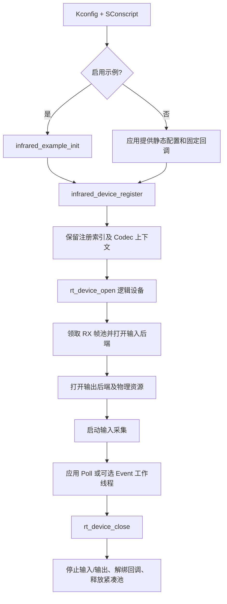

# 架构与资源生命周期

[返回 README](../README.md) · [接收](reception.md) · [发送与 Codec](transmission-codec.md) · [配置](configuration.md)

## 1. 工程边界与构建关系

`SConscript` 在 `INFRARED_LEGACY` 与 `INFRARED_FRAMEWORK` 中选择一组文件；两条路径没有共享的运行时对象或解码器表。

| 功能域 | 仓库相对路径与实现入口 | 输入、输出及责任 |
|---|---|---|
| 设备注册及 RT-Thread 逻辑设备 | `framework/src/infrared_device.c`、`framework/inc/infrared_device.h`；`infrared_device_register()`、`infrared_device_poll()` | 静态实例表、物理资源所有权、打开关闭、帧 IO |
| Capture/PWM 固定回调分发 | `framework/src/infrared_callback.c`；`infrared_device_dispatch_rx()`、`infrared_device_dispatch_tx()` | 根据常量设备索引找到实例，并核对物理句柄归属；中断中不扫描全部物理设备 |
| 原始脉冲采集 | `framework/src/backends/input/infrared_pin.c`、`framework/src/backends/input/infrared_capture.c` | PIN/HWTIMER 或 RT-Thread Input Capture，分别从底层队列取脉冲 |
| 发送包络 | `framework/src/backends/output/infrared_pwm.c`；`infrared_pwm_ops` | PWM 载波、HWTIMER MARK/SPACE 定时、输出完成通知 |
| 流式协议处理 | `framework/codecs/nec/nec_codec.c`；`infrared_nec_codec` | NEC 独立解析上下文、每次解码脉冲、完整帧编码 |
| 可选示例与命令行 | `framework/examples/infrared_example.c`、`framework/examples/infrared_msh.c` | Kconfig 配置实例及事件线程；MSH 仅诊断/交互 |
| LEGACY 单实例模式 | `src/infrared.c`、`src/drv_infrared.c`、`src/nec_decoder.c` | 全局红外对象、原始脉冲 Ringbuffer、原始 NEC 实现 |

`framework/inc/infrared_device_define.h` 提供 `IR_DEFINE_DEVICE(n, codec_ops)` 等宏，根据 `INFRARED_DEVn_*` 配置在编译期生成**普通 C 固定回调和配置**，不运行代码生成脚本。这个头只负责声明辅助，不负责设备注册或 IRQ 生命周期。

## 2. 初始化与资源所有权

- **注册阶段**：`infrared_device_register()` 拷贝配置到 `infrared_devices[INFRARED_MAX_DEVICES]` 的显式索引，不按照注册次序压缩；调用 `rt_device_register()` 发布逻辑设备。注册不是打开物理设备。框架没有运行期注销 API。
- **打开阶段**：`framework/src/infrared_device.c::infrared_rt_open()` 申请完成帧缓存并打开输入/输出后端，然后启动输入。任一步骤返回错误时，仅按已获得的资源执行一次必要回滚，并保留首先发生的错误码；回滚自身失败只记录日志，不触发第二轮清理。
- **关闭及失败边界**：`framework/src/infrared_device.c::infrared_rt_close()` 对 TX 与 RX 分别尝试一次关闭，不因一侧失败而跳过另一侧；返回第一个关闭错误。后端单次执行停止、回调解绑及物理关闭，不调用 `infrared_device_close_physical()` 恢复引用，也不提供 `infrared_device_cleanup()` 重试。若硬件停机、回调解绑或物理关闭未确认成功，将返回错误并保留仍可能被访问的静态缓存/资源声明，避免误复用；业务层依据错误日志安排 BSP/整机恢复，而不是要求框架无限兜底。所有关闭操作要求业务层先确保没有并发 `poll`、TX 或仍在执行的回调。
- **示例初始化**：`INFRARED_USING_EXAMPLE` 使 `infrared_example_init()` 经 `INIT_APP_EXPORT` 运行并注册启用槽位；只有额外启用 `INFRARED_USING_THREAD_EXAMPLE`，它才打开示例设备、初始化 RT-Thread Event 和创建 `ir_event` 线程。手动模式不创建工作线程。

### OPEN / CLOSE / RX / TX 失败处理共识

- **执行次数**：失败时最多做本次调用必要的一次回滚或关闭尝试；不创建重试队列、恢复状态机、额外的 `cleanup()` API，不篡改物理 `ref_count`。
- **返回与日志**：`open`、`close`、`receive_enable`、`poll` 使用 `rt_err_t` 报告错误并记录关键硬件失败；`write_frames`、`rt_device_write` 因 RT-Thread 帧数接口限制只返回成功完成帧数，错误通过日志暴露，不能把部分成功当作全成功。
- **不可安全复用的异常状态**：若不能确认中断回调和硬件已停止，不释放可能被中断引用的静态缓存或资源独占声明；此时框架不会自行恢复，业务层需执行 BSP 故障排除或系统重新初始化。

## 3. RT-Thread / ISR 执行边界

| 执行位置 | 源码入口 | 涉及的共享数据与后续消费者 |
|---|---|---|
| GPIO 边沿回调 | `infrared_pin_irq()` | HWTIMER 时间戳、PIN 脉冲 Ringbuffer，通知应用注册的 RX hook |
| Input Capture 回调 | 固定 `ir_cfg_capture_callback_n()` → `infrared_device_dispatch_rx()` | 验证 `claimed_input` 与回调物理设备匹配，通知上层处理 |
| 应用线程或示例工作线程 | `infrared_device_poll()` | 读取单条脉冲，执行 Codec 状态机，将完整帧写入框架帧 Ringbuffer |
| HWTIMER 完成回调 | 固定 `ir_cfg_pwm_callback_n()` → `infrared_device_dispatch_tx()` → `infrared_pwm_timeout()` | 根据发送缓存游标切换 PWM、装载下一计时段，结束时 `rt_completion_done()` |
| 发送调用线程 | `infrared_device_write_frames()` → `infrared_send_batch()` | Codec 编码、启动输出、`rt_completion_wait()`、停止输出与错误传播 |

回调 `rt_device_set_rx_indicate()` 的参数是物理设备句柄，缺少应用自定义上下文，因此手动配置 Capture/PWM 需提供对应固定索引 trampoline；PIN 的 `rt_pin_attach_irq()` 可直接传入实例指针。上述回调的实际 ISR 上下文和 API 可用性仍取决于目标 RT-Thread/BSP 版本。

## 4. 物理资源映射

`infrared_device_bind_physical()` 统一检查 RX Capture/HWTIMER 与 TX 包络 HWTIMER 的独占关系；`infrared_device_bind_channel()` 检查 PWM 设备 + 通道的排他占用，并要求同一 PWM 设备的不同通道使用一致的载波周期。逻辑实例允许同时拥有输入和输出：**PWM 载波与 HWTIMER 包络计时是两个配套资源，不是二选一**。

资源名称示例 `timer16`、`timer15`、`pwm4` 和输入 PIN `17` 仅来自 Kconfig 默认值，并非对具体 BSP 的存在性证明。IP 地址、CAN、网络协议、DMA 等不属于这个软件包的实现路径。

## 5. LEGACY 与 FRAMEWORK 的维护边界

- LEGACY 的全局 `infrared_class`、`ir_decoder_register()`、`ir_select_decoder()`、`driver_report_raw_data()` 和 `drv_infrared_init()` 与 FRAMEWORK 的静态多实例表不同；切换 Kconfig 改变编译的 API 集合。
- LEGACY NEC 在 `src/nec_decoder.c` 注册，FRAMEWORK NEC 在 `framework/codecs/nec/nec_codec.c` 通过 `infrared_nec_codec` 提供独立解析状态，两者不共享解码上下文。
- 原有 [红外框架示意图](infrared_frame.png) 保留用于了解基础数据流，不表示 FRAMEWORK 当前的资源生命周期。

修改注册或资源归属时先检查 `framework/src/infrared_device.c` 与 `framework/src/infrared_private.h`；修改 PIN 时间戳或 PWM 包络时序时，再检查对应适配器实现和目标 BSP 的设备计时语义。
