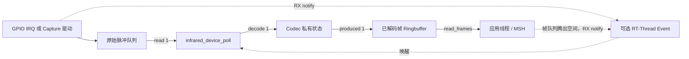

# 接收链路：采样、解码、事件通知

[返回 README](../README.md) · [架构](architecture.md) · [配置](configuration.md)

## 1. 两级队列及处理边界

- **原始队列**：PIN 后端使用 `infrared_pin_state.queue`，每条记录是 `infrared_pulse_t`（4 字节）；Capture 后端调用 `rt_device_read()` 从 BSP 自己管理的 Input Capture 缓冲读取样本。两个后端不会在同一实例同时启用。
- **完整帧队列**：框架 `infrared_rx_state.frame_queue` 以 `struct infrared_frame` 固定记录保存 Codec 输出。它并不会自动解析脉冲。
- **解析入口**：`infrared_device_poll()` 在调用者线程读取**至多一个**原始脉冲，并交给已绑定 Codec 的 `decode()`；返回 `RT_EOK` 表示本次接受一条脉冲，并不表示一定产出完整帧；没有脉冲返回 `-RT_EEMPTY`，已解码帧缓冲无空间返回 `-RT_EFULL`。
- `infrared_device_read_frames()` 和 RT-Thread `read` 的 `count/size` 都是**帧数**，不是字节数。帧入队后若已注册 `parent.rx_indicate`，框架调用该逻辑设备通知。

## 2. PIN + HWTIMER 输入

见 `framework/src/backends/input/infrared_pin.c`：`infrared_pin_open()` 获取 PIN FIFO、定位 HWTIMER、设置频率及模式并挂接双边沿 IRQ；`infrared_pin_start()` 启动定时并开放 PIN 中断。IRQ 读取当前时间、GPIO 电平，以边沿间隔组装 MARK/SPACE 和微秒时长，写入 Ringbuffer。

首次边沿只建立时间基准；异常时间差、HWTIMER 读取失败和队列不足时调用 `infrared_report_overflow()`，由后续 `poll()` 做协议失步处理，不在 ISR 中反复重启硬件。`infrared_pin_read()` 在短暂关中断期间获取完整脉冲记录。PIN 停止/关闭分别执行一次 IRQ 禁用、解绑、计时器停止/物理关闭；出错返回驱动错误并记录日志，不记录跨调用的“阶段完成”标志。若 IRQ 解绑失败，不回收可能仍被回调访问的 PIN FIFO；若物理计时器关闭失败，保留其资源声明，交由业务/BSP 处理。

**周期回绕**：`framework/src/backends/input/infrared_pin.c::infrared_pin_irq()` 使用 `infrared_pin_start()` 设定的 `1000000 us` 计时周期。在 BSP 返回周期内时间戳且本次读值小于上次读值时，按单次回绕计算间隔，例如 `999900 us → 100 us` 对应 `200 us`；否则保持普通无符号时间差计算，以兼容返回累计时间戳的 BSP。直接对周期内读值做无符号相减会产生接近 `2^32 us` 的伪间隔，进而错误触发 Overflow 并中断合法帧解析。周期内时间戳无法单靠相邻读值识别两次及以上未观测回绕，因此采样间隔必须满足该计时方式的限制。

## 3. Input Capture 输入

见 `framework/src/backends/input/infrared_capture.c`：`infrared_capture_open()` 查找 BSP 设备并登记独占归属；`infrared_capture_start()` 打开物理设备、设置 `INPUTCAPTURE_CMD_SET_WATERMARK`，并把用户提供的固定回调通过 `rt_device_set_rx_indicate()` 绑定到物理 Capture 设备。

`infrared_capture_read()` 从 BSP Input Capture 队列取一条 `rt_inputcapture_data` 并依据 `active_level` 映射 MARK/SPACE；`infrared_capture_flush()` 有条件地调用 `INPUTCAPTURE_CMD_CLEAR_BUF`。清空命令与 ISR 的同步性取决于 BSP。该模式依赖 `RT_USING_HEAP`，用于目标 RT-Thread 3.1.x 实现的内部缓冲。`infrared_capture_start()` 打开物理设备并设置水位线/回调，错误直接返回；调用层负责一次关闭尝试。`infrared_capture_stop()` 尽力解绑回调及关闭物理设备，不自动重试或维护 callback-detached 阶段状态；失败时记录日志并避免错误复用物理声明。

`infrared_device_receive_enable()` 仅执行一次必要的原始队列清空，不进行自动重试。启用 RX 时，启动前的清空若返回实际硬件错误，则记录错误码并停止本次启动；若返回 `-RT_ENOSYS`（后端不支持可选的预清空能力），仅记录告警并继续尝试启动，不保证旧样本已被清除。停用 RX 时，先尝试一次 `stop()`，再尝试一次 `flush()`；两处失败分别记录，优先返回 `stop()` 错误，否则返回 `flush()` 错误，随后复位 Codec。当前 Input Capture 后端在物理设备尚未打开时将清空视为成功，因此正常启停不以 `INPUTCAPTURE_CMD_CLEAR_BUF` 为必要条件；运行期间的显式同步清空仍需 BSP 支持该命令。

## 4. Overflow 与完整帧背压

`infrared_report_overflow()` 从采样路径设置 `rx.overflow` 并执行 RX notify；下一次 `infrared_device_poll()` 取得并清除该标志，调用输入 `flush()` 与 Codec `reset()`，以避免在已丢失脉冲的序列上继续组帧。

当完成帧队列没有一个 `struct infrared_frame` 的空间时，`poll()` 返回 `-RT_EFULL` 并且**不读取原始脉冲**。应用读取完成帧后，`infrared_frame_get()` 调用 RX notify，让应用工作线程再次尝试处理；框架没有为每个实例创建独立线程、没有自动读取缓冲区。

## 5. 显式 RX_FLUSH 的即时与延迟语义

`rt_device_control(rtdev, INFRARED_CTRL_RX_FLUSH, &immediate)` 的 `immediate` 为 `rt_bool_t`：

- `RT_TRUE`：**同步**请求后端清除原始脉冲，然后复位 Codec，并清空框架完整帧队列。全部完成才返回 `RT_EOK`；例如 Capture BSP 缺少 `INPUTCAPTURE_CMD_CLEAR_BUF` 时返回 `-RT_ENOSYS`，旧数据不可视为已清空。
- `RT_FALSE`：设置 `rx.flush_pending` 并通知可选接收工作线程，**下一次 `infrared_device_poll()` 开始时**执行同样的完整清空；控制命令的 `RT_EOK` 仅表示已受理。执行失败会保留待清空标志，`poll()` 返回相应错误。

与上述人工请求不同，采样异常设置的 `rx.overflow` 是失步恢复信号：下次 Poll 重置原始样本/Codec，**不清除之前已解码的完整帧**。对不支持清空控制的 Capture BSP，自动 Overflow 继续保留原有的 Codec 复位降级处理，而显式清空返回失败。无论采用哪种方式，同一实例的 `flush()`、`poll()`、`read_frames()` 和设备关闭必须由调用方串行化；清空返回后新产生的 IRQ 数据不属于旧缓存。

## 6. 可选 Event 工作线程

`framework/examples/infrared_example.c` 在 `INFRARED_USING_THREAD_EXAMPLE` 时创建 `infrared_example_event` 和一个 `ir_event` 线程，线程入口 `infrared_example_entry()`：

1. `infrared_example_notify()` 按配置实例索引发送事件位（通知不携带原始脉冲）。
2. 工作线程通过 `rt_event_recv(..., RT_EVENT_FLAG_OR | RT_EVENT_FLAG_CLEAR, ...)` 等待唤醒，使用普通 `for` 只处理本轮事件位对应的索引；不使用编译器位扫描内建函数。
3. 每个设备单轮最多执行 `INFRARED_THREAD_POLL_QUOTA` 次 `poll()`；用本地 `pending` 位掩码继续处理配额耗尽的设备，并合并运行期间新到的事件，不在线程内给自己再发 Event。
4. 遇到 `-RT_EEMPTY`、`-RT_EFULL` 或其他错误时停止当前设备这一轮处理。硬件或应用新的通知将决定下一次唤醒。

**线程资源**：示例采用 `rt_thread_create("ir_event", ..., INFRARED_THREAD_EXAMPLE_STACK, INFRARED_THREAD_EXAMPLE_PRIORITY, 10)`，线程栈与优先级由 Kconfig 提供（默认 1024 字节、优先级 20）；Event 对象由示例 `rt_event_init()` 创建。框架核心没有内置工作线程。

**调用方责任**：同一设备的 `poll()`、接收启停、关闭及异步回调生命周期必须由应用串行化；`infrared_device_receive_enable()` 没有独立 `enabled` 布尔门控。`infrared_device_set_rx_notify()` 的 `user_data` 由应用保证有效，通知回调不能阻塞。
