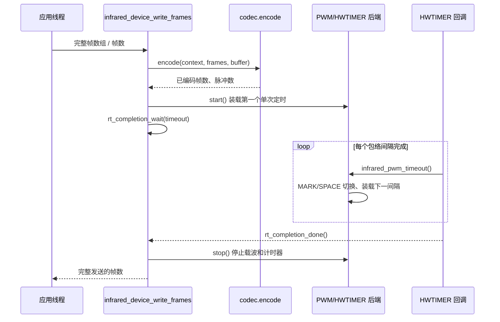

# 发送、包络定时与 NEC Codec

[返回 README](../README.md) · [架构](architecture.md) · [配置](configuration.md)

## 1. 发送调用链

`framework/src/infrared_device.c` 的 `infrared_device_write_frames()` 分批编码**完整协议帧**，`infrared_send_batch()` 使用 `rt_completion_wait()` 等待发送后端的终止通知。`infrared_pwm_timeout()` 在物理 HWTIMER 回调中处理一个 MARK/SPACE 间隔，结束或重新装载失败时写回后端 `transfer.result` 并调用 `rt_completion_done()`。

`timeout_ticks` 是 `rt_int32_t`，单位为 RT-Thread tick，与 `rt_completion_wait()` 的超时参数一致。配置 `0`（保留软件包原有约定）或 `RT_WAITING_FOREVER`（`-1`）表示永久等待；正数表示有限 Tick 等待。除 `RT_WAITING_FOREVER` 外的其他负数不属于有效配置；超过 `rt_int32_t` 可表示范围的整数也不应赋给该字段。框架不对非法配置值增加校验，其输入及运行后果由应用调用方负责。

发送启动、等待或输出失败时，`infrared_send_batch()` 只执行一次后端 `stop()` 并保留第一次错误。`infrared_device_write_frames()` 返回**实际完成的帧数**，不会将负错误码编码进 `rt_size_t`；失败细节通过 `LOG_E/LOG_W` 输出，业务层应同时检查返回数量和日志，不将部分发送当成成功。

## 2. 发送资源与数据所有权

`framework/src/backends/output/infrared_pwm.c` 使用 `struct infrared_pwm_state` 的紧凑池。每个状态包含后端专有的 ISR `index`、`used` 和稳定脉冲数组 `storage[INFRARED_TX_PULSE_CAPACITY]`；首成员 `struct infrared_tx_buffer transfer` 是框架与后端共享的**已编码脉冲指针、容量、有效数量和错误结果**契约。

`infrared_tx_state.user_data` 指向 PWM 后端状态池，不写入物理 `rt_device.user_data`。框架负责 HWTIMER 独占归属与 PWM 通道声明，后端负责载波和发送 ISR。`framework/src/backends/output/infrared_pwm.c::infrared_pwm_close()` 只尝试一次停止载波、解绑回调和关闭定时器；错误通过 `framework/src/infrared_device.c::infrared_rt_close()` 向上返回并记录日志，不执行物理引用修复或重试。PWM `open()` 期间若载波禁用失败，不释放其通道声明；任一关闭步骤未确认成功时保留可能被 ISR 访问的状态池与相关占用，不让另一个实例错误复用。业务/BSP 负责判断是否需要复位硬件或重启系统。

| 物理对象 | 作用 | 使用规则 |
|---|---|---|
| PWM 设备/通道 | MARK 时产生载波、SPACE 时关闭载波 | 同通道不允许被两个红外实例同时声明；相同 PWM 设备上的不同通道要求一致载波周期 |
| HWTIMER | 为每个包络段提供单次计时并触发中断 | 作为回调生成者由一个红外实例独占，不与 RX 物理计时器共用 |
| 后端脉冲数组 | 保存一次已编码的 MARK/SPACE 时长序列 | 发送操作结束前保持稳定，不是 TX Ringbuffer |

`infrared_pwm_open()` 配置载波与包络计时器；默认常量在源码中分别为周期 `26316 ns`、有效高电平 `8770 ns`、HWTIMER `1000000 Hz`，开始前另有 `500 us` 初始计时段。它们是源码中的目标设定值，**不是实测载波频率或输出误差**。

## 3. 原始脉冲及完整帧格式

`framework/inc/infrared_codec.h` 定义 `infrared_pulse_t` 为 32 位整数：高 4 位 `0xA` 表示 MARK，`0xB` 表示 SPACE；低 28 位是**微秒**时长（宏 `INFRARED_PULSE_PACK/LEVEL/DURATION`）。这两个标记是编码格式，不等于 GPIO 的电平值。

`struct infrared_frame` 保存 `length` 和 `data[INFRARED_FRAME_MAX_BYTES]`；FRAMEWORK 使用固定大小记录并在尾部按 `RT_ALIGN_SIZE` 填充对齐字节。编码器一次调用可输出多个完整帧，但不能将半帧当成成功；接收端 `decode()` 通过私有上下文跨次保存状态。

## 4. NEC 协议实现

`framework/codecs/nec/nec_codec.c` 提供 `infrared_nec_codec`，其 `context_for_index()` 从紧凑的 `infrared_nec_slots[INFRARED_NEC_CONTEXT_COUNT]` 中为固定逻辑设备索引分配解析上下文；该槽位同时保存 `context`、`owner`、`used`，纯发送实例不需要接收解析状态。

接收实现按 `NEC_GUIDE_MARK → NEC_GUIDE_SPACE → NEC_DATA_MARK/SPACE → NEC_TRAILER_MARK` 处理 32 位数据，校验地址与命令的反码字节；有效帧产出 `length=3`：`data[0]` 地址、`data[1]` 命令、`data[2]` 重复次数。识别重发帧使用上一条有效命令及独立 repeat 状态。异常脉冲会复位不完整状态机；允许设置 `INFRARED_NEC_TOLERANCE_US`，但引导码另按源码固定匹配窗口。

发送 `nec_encode()` 为每个正常帧生成 68 个包络段，每个重复附加 4 个段；应用指定的重复数超过 8 会被编码器截断。按 `INFRARED_TX_PULSE_CAPACITY` 约束一个批次中能装入的**完整帧**数量。这里列出的编码形式是当前程序的行为，不表示对 NEC 所有变体（如扩展地址）的支持。

## 5. 增加其他 Codec

实现 `framework/inc/infrared_codec.h` 的 `infrared_codec_ops`：`reset`、`decode`、`encode` 以及可选的 `context_for_index`，再在 `infrared_device_config.codec` 绑定对应操作表及持久有效的上下文。**当前不支持通过 MSH 或运行中更换已注册实例的 Codec**。新协议的 MSH 解析代码可按 NEC 模式独立维护，再由通用 MSH 显式选编分发；不要将协议解析塞进 PIN/PWM 后端。
